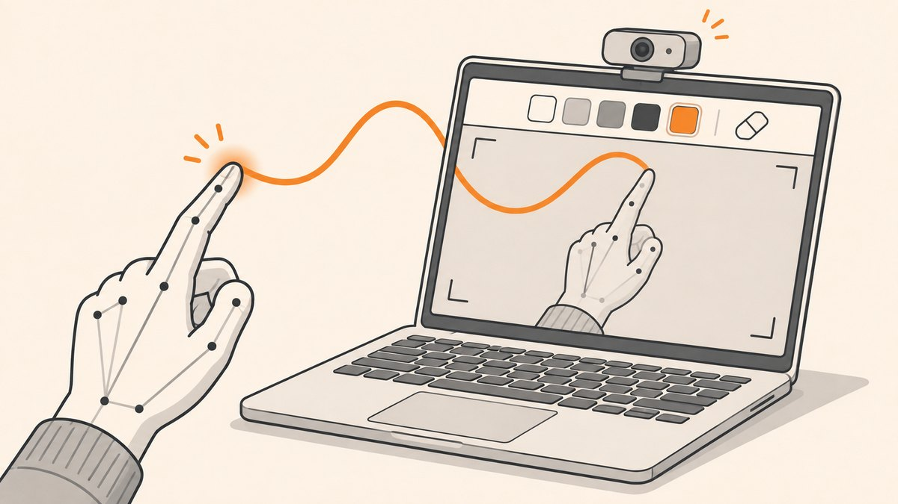

<p align="center"></p>

# Air Canvas

Draw on your webcam feed with your index finger, using MediaPipe hand tracking and OpenCV.

## What it does

- Opens the webcam at 1280x720, mirrors it, and tracks one hand in real time.
- **Index finger up only:** drawing mode. The fingertip leaves a line on a persistent canvas that is blended over the live video.
- **Index and middle fingers up:** selection mode. Drawing stops, and moving the fingertip into the top toolbar (the top 125 px) picks a colour or the eraser.
- Three colours (magenta, red, green) with an 8 px brush, plus a 50 px eraser.

## How it works

`HandTrackingModule.py` wraps MediaPipe Hands in a small `handDetector` class: `findHands` runs detection, `findPosition` returns the 21 landmarks as pixel coordinates, and `fingersUp` reports which fingers are raised by comparing each fingertip with the joint below it.

`AirCanvas.py` loads the toolbar images from `Header/`, reads landmark 8 (index tip) and 12 (middle tip) every frame, and switches between selection and drawing mode from `fingersUp()`. Strokes are drawn with `cv2.line` onto a black canvas. Each frame, the canvas is thresholded into a mask, cut out of the camera image with `bitwise_and`, and merged back with `bitwise_or`, so strokes appear on top of the video. The current toolbar image is pasted over the top 125 rows.

## Tech

- Python 3
- OpenCV (`cv2`)
- MediaPipe (`mediapipe`, Hands solution)
- NumPy

## Run it

Needs a webcam.

```bash
pip install opencv-python mediapipe numpy
cd AirCanvas
python AirCanvas.py
```

Run it from inside `AirCanvas/`, because the `Header` folder is loaded by relative path.

## Project structure

- `AirCanvas/AirCanvas.py`: main loop, mode switching, drawing and canvas blending.
- `AirCanvas/HandTrackingModule.py`: reusable MediaPipe hand detector (landmarks, fingers-up check). Runs a standalone FPS demo when executed directly.
- `AirCanvas/Header/`: 1280x125 toolbar images, one per selected tool (`blueColor.png`, `greenColor.png`, `redColor.png`, `Eraser.png`).
- `AirCanvas/__pycache__/`: compiled Python cache, committed by accident.

## Notes

- There is no quit key: the loop never exits, so close it with Ctrl+C or by stopping the process.
- The toolbar images are loaded with `os.listdir`, so which image appears for which tool depends on the file system's listing order.
- `handDetector` passes its settings to `mp.solutions.hands.Hands` positionally. Newer MediaPipe releases added a `model_complexity` argument in that position, so an older MediaPipe (0.8.x) may be needed, or the call changed to keyword arguments.
- Tool hit zones in the toolbar are hard-coded x ranges for a 1280 px wide frame.
